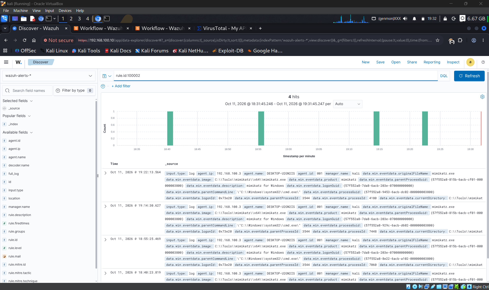
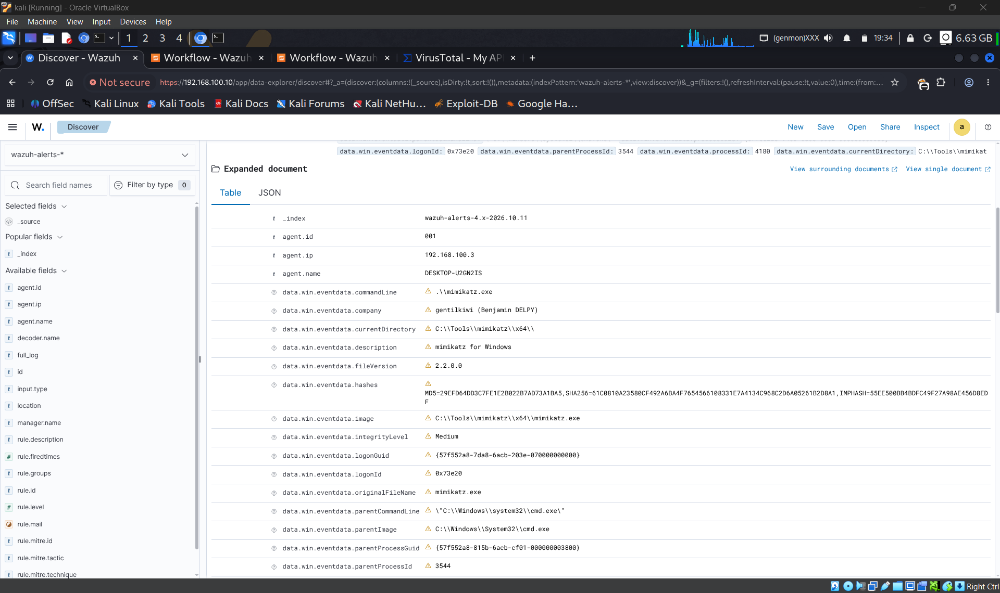
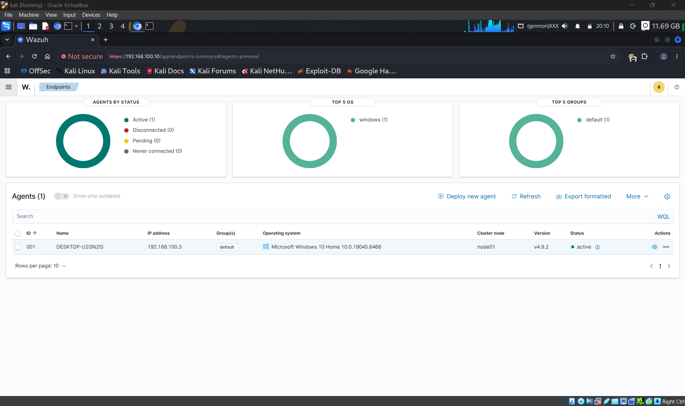
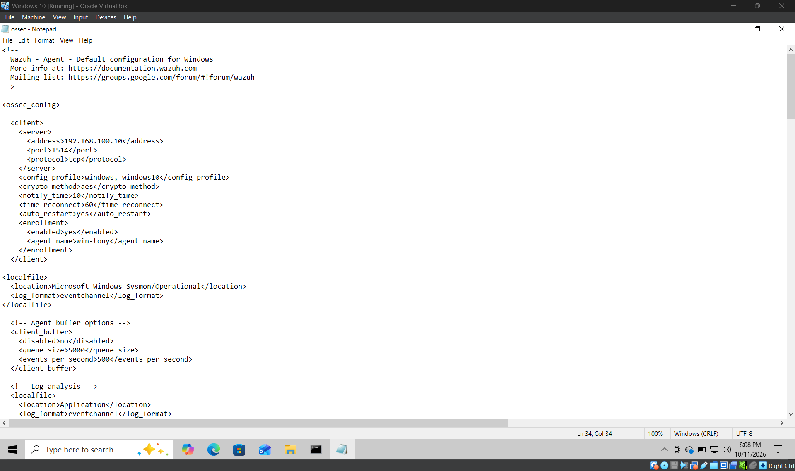
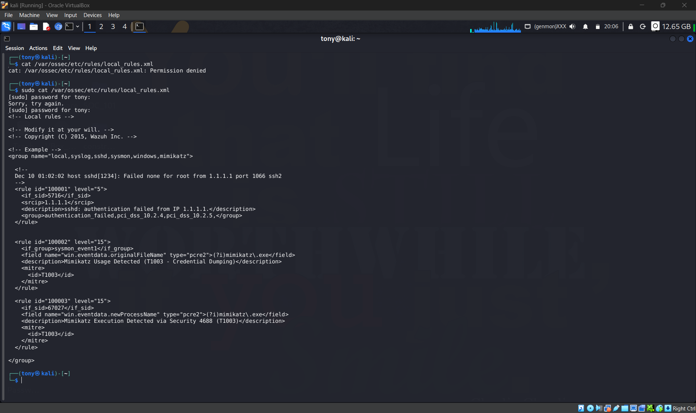
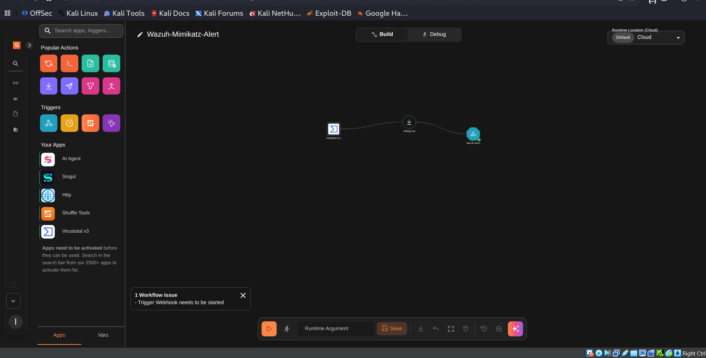
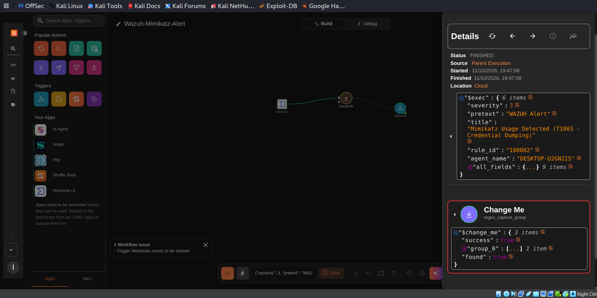
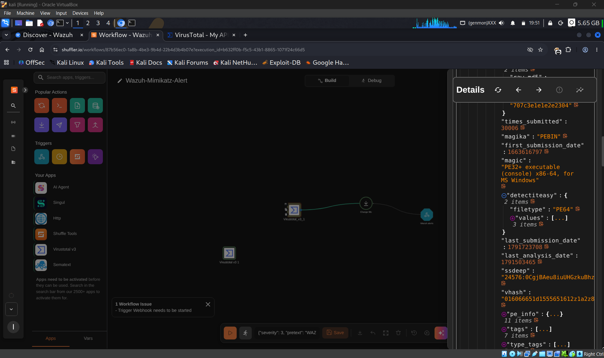
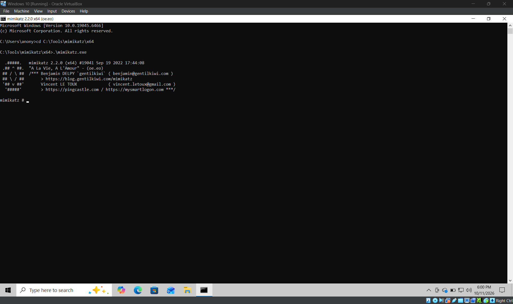

# 🛡️ SOC Automation Lab: Wazuh + Shuffle + VirusTotal

> **An automated mini Security Operations Center (SOC).** When an attacker tool (**Mimikatz**) runs on a Windows PC, this lab detects it, pulls out the file's fingerprint (SHA256 hash), and asks VirusTotal "is this malware?" — all **automatically**, with no human clicking anything.


**Stack:** Wazuh 4.9 · Sysmon · Shuffle · VirusTotal · Kali Linux · Windows 10

---

## 📖 Table of Contents

1. [What This Project Does](#-what-this-project-does)
2. [Key Terms (Beginner Glossary)](#-key-terms-beginner-glossary)
3. [Architecture](#-architecture)
4. [Prerequisites](#-prerequisites)
5. [Step 1: Set Up Kali (Wazuh Manager)](#-step-1-set-up-kali-wazuh-manager)
6. [Step 2: Prepare Windows 10 (Endpoint)](#-step-2-prepare-windows-10-endpoint)
7. [Step 3: Install Sysmon on Windows](#-step-3-install-sysmon-on-windows)
8. [Step 4: Install the Wazuh Agent on Windows](#-step-4-install-the-wazuh-agent-on-windows)
9. [Step 5: Write the Custom Detection Rules](#-step-5-write-the-custom-detection-rules)
10. [Step 6: Build the Shuffle Workflow](#-step-6-build-the-shuffle-workflow)
11. [Step 7: Connect Wazuh to Shuffle](#-step-7-connect-wazuh-to-shuffle)
12. [Step 8: Test the Pipeline](#-step-8-test-the-pipeline)
13. [Screenshots](#-screenshots)
14. [MITRE ATT&CK Coverage](#-mitre-attck-coverage)
15. [Troubleshooting](#-troubleshooting)
16. [Lessons Learned](#-lessons-learned)
17. [Future Enhancements](#-future-enhancements)
18. [References](#-references)

---

## 🎯 What This Project Does

When Mimikatz runs on the Windows endpoint, this happens in order:

| # | Who | What happens |
|---|-----|--------------|
| 1 | **Sysmon** | Records that a new process started (Event ID 1) |
| 2 | **Wazuh Agent** | Sends that record to the Wazuh Manager on Kali |
| 3 | **Wazuh Manager** | Custom rule `100002` matches → fires a **level 15** alert mapped to MITRE **T1003** |
| 4 | **Integration script** | Forwards the alert to Shuffle through a webhook |
| 5 | **Shuffle** | Extracts the file's **SHA256 hash** using a regex |
| 6 | **VirusTotal** | Returns the file's reputation (50+ antivirus engines flag it) |

**Result:** detection + enrichment in seconds, with **zero manual analyst work**.

---

## 📚 Key Terms (Beginner Glossary)

New to security tooling? Here is every tool in plain English.

| Term | Plain-English meaning |
|------|----------------------|
| **SOC** | Security Operations Center — the team/system that watches for attacks |
| **SIEM** | A system that collects logs and raises alerts. **Wazuh** is our SIEM |
| **SOAR** | A system that automates the response to alerts. **Shuffle** is our SOAR |
| **Endpoint** | A computer being protected (our Windows 10 VM) |
| **Sysmon** | A free Microsoft tool that records detailed activity (processes, files, network) |
| **Agent** | A small program on the endpoint that sends logs to the manager |
| **Mimikatz** | A famous hacking tool that steals Windows passwords from memory |
| **SHA256 hash** | A unique 64-character "fingerprint" of a file |
| **VirusTotal** | A website that checks a file hash against 50+ antivirus engines |
| **Webhook** | A URL that receives data from another program |
| **Regex** | A pattern used to pull specific text out of a bigger block of text |
| **MITRE ATT&CK** | A public catalogue of attacker techniques. **T1003** = credential dumping |

---

## 🏗️ Architecture

```
┌─────────────────────────────────────────────────────────────┐
│  Windows 10 Endpoint (192.168.100.3)                        │
│  ┌─────────────┐         ┌─────────────────────────────┐    │
│  │   Sysmon    │────┐    │   Wazuh Agent               │    │
│  │  (EID 1,    │    └───▶│   Forwards Sysmon logs      │    │
│  │   EID 11)   │         │   to Manager on port 1514   │    │
│  └─────────────┘         └──────────────┬──────────────┘    │
└─────────────────────────────────────────┼───────────────────┘
                                          │ TCP/1514
                                          ▼
┌─────────────────────────────────────────────────────────────┐
│  Kali Linux — Wazuh Manager (192.168.100.10)                │
│  ┌──────────────────────────────────────────────────────┐   │
│  │  Rule 100002: Sysmon EID 1 + originalFileName =      │   │
│  │  mimikatz.exe → Level 15, MITRE T1003                │   │
│  └──────────────────────┬───────────────────────────────┘   │
│                         │                                   │
│  ┌──────────────────────▼───────────────────────────────┐   │
│  │  custom-shuffle.py integration                       │   │
│  │  POSTs the alert JSON to the Shuffle webhook         │   │
│  └──────────────────────┬───────────────────────────────┘   │
└─────────────────────────┼───────────────────────────────────┘
                          │ HTTPS
                          ▼
┌─────────────────────────────────────────────────────────────┐
│  Shuffle SOAR (cloud)                                       │
│  ┌────────────┐   ┌────────────┐   ┌────────────────────┐   │
│  │  Webhook   │──▶│ Regex Node │──▶│  VirusTotal v3     │   │
│  │  Trigger   │   │ SHA256     │   │  Hash Report       │   │
│  └────────────┘   └────────────┘   └─────────┬──────────┘   │
└──────────────────────────────────────────────┼──────────────┘
                                               │ HTTPS
                                               ▼
                                     ┌────────────────────┐
                                     │   VirusTotal API   │
                                     │   50+ detections   │
                                     └────────────────────┘
```

---

## ✅ Prerequisites

| Requirement | Notes |
|-------------|-------|
| **Kali Linux VM** | **4 GB RAM minimum (8 GB recommended)**. Runs the Wazuh Manager |
| **Windows 10 VM** | 4 GB RAM minimum. The monitored endpoint |
| **VirtualBox / VMware** | To run the VMs |
| **Network** | Both VMs on the **same network** and **with internet access** (use a *NAT Network* — a host-only network has no internet, and Shuffle/VirusTotal need it) |
| **Shuffle account** | Free: https://shuffler.io |
| **VirusTotal account** | Free: https://www.virustotal.com (copy your API key) |
| **Basic Linux CLI** | `nano`, `systemctl`, `curl` |

> [!NOTE]
> In my lab, Kali is `192.168.100.10` and Windows is `192.168.100.3`. Replace these with your own IPs everywhere they appear.

> [!WARNING]
> Mimikatz is a real attack tool. Run this lab **only on isolated VMs you own**. Never run it on a machine that matters.

---

## 🐉 Step 1: Set Up Kali (Wazuh Manager)

**Goal:** turn the Kali VM into the "brain" that receives logs and raises alerts.

### 1.1 Install Wazuh

```bash
curl -sO https://packages.wazuh.com/4.9/wazuh-install.sh
sudo bash ./wazuh-install.sh -a
```

This takes 10–20 minutes and installs the Wazuh **Manager**, **Indexer**, and **Dashboard**.

> [!NOTE]
> Kali is not on Wazuh's officially supported OS list. If the installer stops with an "unsupported OS" message, re-run it with the ignore-checks flag: `sudo bash ./wazuh-install.sh -a -i`

> [!IMPORTANT]
> When the script finishes it prints a random **admin password**. **Save it immediately** — you need it to log in.

### 1.2 Open the Firewall Ports

*(Only needed if `ufw` is installed and active on your Kali.)*

```bash
sudo ufw allow 443/tcp    # Dashboard (HTTPS)
sudo ufw allow 1514/tcp   # Agent → Manager logs
sudo ufw allow 1515/tcp   # Agent enrollment
```

### 1.3 Find Your Kali IP

```bash
hostname -I
```

Write it down — this is your **Wazuh Manager IP** (`192.168.100.10` in this guide).

### 1.4 Open the Dashboard

Browse to `https://192.168.100.10`, accept the self-signed certificate warning, and log in as `admin` with the saved password.

✅ **Checkpoint:** you can see the Wazuh dashboard.

---

## 🪟 Step 2: Prepare Windows 10 (Endpoint)

**Goal:** get Windows ready so Mimikatz isn't deleted by Defender and the network works.

### 2.1 Add Windows Defender Exclusions

Defender will quarantine Mimikatz. In an **Admin PowerShell**:

```powershell
Add-MpPreference -ExclusionPath "C:\Tools"
Add-MpPreference -ExclusionPath "C:\Users\<your-username>\Downloads"
```

### 2.2 Verify Network Connectivity

```powershell
Test-NetConnection -ComputerName 192.168.100.10 -Port 1514
```

You want `TcpTestSucceeded : True`. If it is `False`, the VMs are not on the same network (or the Kali firewall is blocking) — fix this before continuing.

✅ **Checkpoint:** `TcpTestSucceeded : True`.

---

## 🔍 Step 3: Install Sysmon on Windows

**Goal:** give Windows a "security camera" that records every process that starts. Without Sysmon, Wazuh can't see Mimikatz's real file name.

### 3.1 Download Sysmon

```powershell
Invoke-WebRequest -Uri https://download.sysinternals.com/files/Sysmon.zip -OutFile $env:TEMP\Sysmon.zip
Expand-Archive -Path $env:TEMP\Sysmon.zip -DestinationPath C:\Sysmon -Force
```

### 3.2 Download the SwiftOnSecurity Config

A well-known baseline config that captures useful events without too much noise:

```powershell
Invoke-WebRequest -Uri https://raw.githubusercontent.com/SwiftOnSecurity/sysmon-config/master/sysmonconfig-export.xml -OutFile C:\Sysmon\sysmonconfig.xml
```

### 3.3 Install Sysmon

```powershell
cd C:\Sysmon
.\Sysmon64.exe -accepteula -i .\sysmonconfig.xml
```

### 3.4 Verify It Is Running

```powershell
Get-Service Sysmon64
.\Sysmon64.exe -c
```

Expect status **Running** and your config printed.

### 3.5 Generate a Test Event

```powershell
whoami.exe
```

Open **Event Viewer → Applications and Services Logs → Microsoft → Windows → Sysmon → Operational**. A new **Event ID 1 (Process Create)** should be there.

✅ **Checkpoint:** you see Event ID 1 for `whoami.exe`.

---

## 📥 Step 4: Install the Wazuh Agent on Windows

**Goal:** connect Windows to the Wazuh Manager and send it the Sysmon logs.

### 4.1 Generate the Install Command

In the Wazuh dashboard: **Agents management → Deploy new agent**, then:

1. Choose **Windows**
2. Enter the Kali IP as the server address (`192.168.100.10`)
3. Name the agent (e.g. `win-tony`)
4. Copy the PowerShell command it generates

### 4.2 Run It on Windows (Admin PowerShell)

It will look like this:

```powershell
Invoke-WebRequest -Uri https://packages.wazuh.com/4.x/windows/wazuh-agent-4.9.2-1.msi -OutFile $env:TEMP\wazuh-agent.msi
msiexec.exe /i $env:TEMP\wazuh-agent.msi /q WAZUH_MANAGER='192.168.100.10' WAZUH_AGENT_NAME='win-tony'
```

> [!TIP]
> The agent version must be **equal to or lower than** the manager version. Always use the command the dashboard generates.

### 4.3 Start the Agent

```powershell
Start-Service -Name WazuhSvc
Get-Service -Name WazuhSvc
```

### 4.4 Confirm in the Dashboard

Refresh **Agents** — your agent should show a green **Active** status.

### 4.5 Tell the Agent to Forward Sysmon Logs

Open **Notepad as Administrator** and edit:

```
C:\Program Files (x86)\ossec-agent\ossec.conf
```

Inside `<ossec_config>`, add:

```xml
<localfile>
  <location>Microsoft-Windows-Sysmon/Operational</location>
  <log_format>eventchannel</log_format>
</localfile>
```

Save (make sure the file is still `ossec.conf`, **not** `ossec.conf.txt`), then restart:

```powershell
Restart-Service -Name WazuhSvc
```

### 4.6 Confirm Events Are Flowing

On Kali:

```bash
sudo tail -f /var/ossec/logs/alerts/alerts.json | grep -i sysmon
```

Run `whoami.exe` on Windows — Sysmon JSON should scroll by.

✅ **Checkpoint:** Sysmon events appear on Kali.

---

## 📝 Step 5: Write the Custom Detection Rules

**Goal:** teach Wazuh what "Mimikatz" looks like.

### 5.1 Open the Local Rules File

```bash
sudo nano /var/ossec/etc/rules/local_rules.xml
```

### 5.2 Add the Mimikatz Rules

```xml
<group name="sysmon,windows,mimikatz,">
  <rule id="100002" level="15">
    <if_group>sysmon_event1</if_group>
    <field name="win.eventdata.originalFileName" type="pcre2">(?i)mimikatz\.exe</field>
    <description>Mimikatz Usage Detected (T1003 - Credential Dumping)</description>
    <mitre>
      <id>T1003</id>
    </mitre>
  </rule>

  <rule id="100003" level="15">
    <if_sid>67027</if_sid>
    <field name="win.eventdata.newProcessName" type="pcre2">(?i)mimikatz\.exe</field>
    <description>Mimikatz Execution Detected via Security 4688 (T1003)</description>
    <mitre>
      <id>T1003</id>
    </mitre>
  </rule>
</group>
```

**Why two rules?**

| Rule | Watches | Why it exists |
|------|---------|---------------|
| `100002` | Sysmon **Event ID 1** (Process Create) | Uses `originalFileName` — the name baked *inside* the executable. Renaming `mimikatz.exe` to `totally_legit.exe` **does not fool it** |
| `100003` | Windows Security **Event 4688** | Fallback if Sysmon is not installed |

> [!NOTE]
> Rule `100003` only works if Windows auditing of **Process Creation** (and command-line logging) is enabled. The main detection in this lab is rule `100002`.

### 5.3 Test the Config, Then Restart

```bash
sudo /var/ossec/bin/wazuh-analysisd -t       # syntax check; no output = good
sudo systemctl restart wazuh-manager
```

### 5.4 Confirm No Errors

```bash
sudo grep -i "error" /var/ossec/logs/ossec.log | tail
```

✅ **Checkpoint:** no rule/XML errors.

---

## 🔄 Step 6: Build the Shuffle Workflow

**Goal:** build the automation that receives the alert, extracts the hash, and asks VirusTotal.

### 6.1 Create a Free Account

Sign up at https://shuffler.io (Google login is fastest).

### 6.2 Create the Workflow

1. **Workflows → + Create Workflow**
2. Name it `Wazuh-Mimikatz-Alert`
3. Choose **Create from scratch**

### 6.3 Add the Webhook Trigger

1. Drag the **Webhook** node onto the canvas
2. Rename it `Wazuh alerts`
3. **Copy the webhook URL:**
   ```
   https://shuffler.io/api/v1/hooks/webhook_xxxxxxxx-xxxx-xxxx-xxxx-xxxxxxxxxxxx
   ```
4. Save it — you need it in Step 7

> [!CAUTION]
> Treat the webhook URL like a password. Anyone with it can send data into your workflow. Never commit it to GitHub.

### 6.4 Add the Regex Node (extract the SHA256)

1. Drag a **Change Me** node onto the canvas and connect it **after** the webhook
2. Set the action to **Regex capture group**
3. Fill in:
   - **Input data:** `$exec.all_fields.data.win.eventdata.hashes`
   - **Regex:** `SHA256=([A-Fa-f0-9]{64})`
4. Save

### 6.5 Add the VirusTotal Node

1. Open **Apps** in the left sidebar and search **VirusTotal**
2. Drag **VirusTotal v3** onto the canvas and connect it **after** the Regex node
3. Set the action to **Get a hash report**
4. Click **Authenticate VirusTotal v3** and paste your API key
5. In the **id** field, click the **+** button and insert:
   - Node: **Change Me**
   - Field: **group_0** → first item (shows as `$change_me.group_0.0`)
6. Save

> [!WARNING]
> **Shuffle 1.2.0 quirk:** always insert variables with the **+ button**. Typing `$change_me.group_0.0` by hand may not resolve. If it still fails, try `$change_me.group_0.#0`.

### 6.6 Start the Webhook

Click **Start** on the Webhook node — it should show a green **Running** indicator.

✅ **Checkpoint:** workflow = `Webhook → Change Me → VirusTotal`, webhook running.

---

## 🔗 Step 7: Connect Wazuh to Shuffle

**Goal:** make Wazuh push alerts into the Shuffle webhook.

> [!NOTE]
> The built-in `shuffle` integration in Wazuh 4.9.x has a bug (the options file path isn't passed correctly, so it fails silently). We replace it with a small custom integration that works.

### 7.1 Create the Python Script

```bash
sudo tee /var/ossec/integrations/custom-shuffle.py > /dev/null <<'EOF'
#!/usr/bin/env python3
import sys, json, requests

alert_file = sys.argv[1]
hook_url = sys.argv[3]
LOG = '/var/ossec/logs/integrations.log'

try:
    with open(alert_file) as f:
        alert = json.load(f)

    payload = {
        "severity": 3,
        "pretext": "WAZUH Alert",
        "title": alert.get('rule', {}).get('description', 'N/A'),
        "rule_id": alert.get('rule', {}).get('id', 'unknown'),
        "agent_name": alert.get('agent', {}).get('name', 'unknown'),
        "all_fields": alert,
    }

    r = requests.post(
        hook_url,
        json=payload,
        headers={"Content-Type": "application/json"},
        timeout=10
    )

    with open(LOG, 'a') as log:
        log.write(f"custom-shuffle: rule={payload['rule_id']} status={r.status_code}\n")

except Exception as e:
    with open(LOG, 'a') as log:
        log.write(f"custom-shuffle ERROR: {e}\n")
EOF
```

### 7.2 Create the Wrapper Script

Wazuh runs a file named exactly like the integration (`custom-shuffle`); this wrapper launches the Python script.

```bash
sudo tee /var/ossec/integrations/custom-shuffle > /dev/null <<'EOF'
#!/bin/sh
/usr/bin/python3 /var/ossec/integrations/custom-shuffle.py "$@"
EOF
```

### 7.3 Set Permissions

```bash
sudo chmod 750 /var/ossec/integrations/custom-shuffle
sudo chmod 750 /var/ossec/integrations/custom-shuffle.py
sudo chown root:wazuh /var/ossec/integrations/custom-shuffle
sudo chown root:wazuh /var/ossec/integrations/custom-shuffle.py
```

### 7.4 Register the Integration in `ossec.conf`

```bash
sudo nano /var/ossec/etc/ossec.conf
```

Inside `<ossec_config>`, add:

```xml
<integration>
  <name>custom-shuffle</name>
  <hook_url>PASTE_YOUR_SHUFFLE_WEBHOOK_URL_HERE</hook_url>
  <rule_id>100002</rule_id>
  <alert_format>json</alert_format>
</integration>
```

### 7.5 Restart the Manager

```bash
sudo systemctl restart wazuh-manager
```

✅ **Checkpoint:** manager restarts with no errors.

---

## 🧪 Step 8: Test the Pipeline

### 8.1 Download Mimikatz (lab VM only)

In **Admin PowerShell** (Defender exclusion from Step 2 must already be set):

```powershell
mkdir C:\Tools -Force
cd C:\Tools
Invoke-WebRequest -Uri https://github.com/gentilkiwi/mimikatz/releases/download/2.2.0-20220919/mimikatz_trunk.zip -OutFile mimikatz.zip
Expand-Archive mimikatz.zip -DestinationPath mimikatz
```

### 8.2 Run It

```powershell
cd C:\Tools\mimikatz\x64
.\mimikatz.exe
```

Type `exit` to close.

### 8.3 Watch the Alert on Kali

```bash
sudo tail -f /var/ossec/logs/alerts/alerts.json | grep -i "100002\|mimikatz"
```

A **level 15** alert should appear within seconds.

### 8.4 Confirm the Integration Fired

```bash
sudo tail -5 /var/ossec/logs/integrations.log
```

Expected:

```
custom-shuffle: rule=100002 status=200
```

### 8.5 Check Shuffle

Open `https://shuffler.io/workflows/debug` and find the newest execution:

| Node | What you should see |
|------|---------------------|
| **Webhook input** | Alert JSON with `title: "Mimikatz Usage Detected..."`, `rule_id: "100002"` |
| **Change Me** | `group_0` containing the SHA256 |
| **VirusTotal** | Status `200`, `last_analysis_stats.malicious` in the 50s |

🎉 **Done!** Your SOC pipeline works end-to-end.

---

## 📸 Screenshots

| # | Image | What it shows |
|---|-------|---------------|
| 1 |  | **Mimikatz detected.** Rule 100002 fired four times in 5 minutes — each bar is one execution |
| 2 |  | **Alert detail.** `originalFileName: mimikatz.exe`, `hashes`, `commandLine`, `parentImage` |
| 3 |  | **Agent active.** The Windows endpoint is reporting |
| 4 |  | **Sysmon forwarding.** The `<localfile>` block in `ossec.conf` |
| 5 |  | **Custom rules.** `local_rules.xml` with 100002 and 100003 |
| 6 |  | **Workflow.** Webhook → Change Me → VirusTotal |
| 7 |  | **SHA256 extraction** by the Change Me node |
| 8 |  | **Enrichment.** VirusTotal confirms a malicious PE executable |
| 9 |  | **Attack simulation.** Mimikatz 2.2.0 running on the endpoint |

---

## 🎯 MITRE ATT&CK Coverage

| Technique | ID | Detection Source |
|-----------|----|------------------|
| OS Credential Dumping | T1003 | Sysmon EID 1 + Rule 100002 |
| OS Credential Dumping (fallback) | T1003 | Security EID 4688 + Rule 100003 |
| Ingress Tool Transfer | T1105 | Sysmon EID 11 (file creation) |

---

## 🧰 Troubleshooting

| Symptom | Likely cause | Fix |
|---------|--------------|-----|
| Agent not **Active** | Network/firewall | Re-run `Test-NetConnection ... -Port 1514`; check `ufw` |
| No Sysmon events on Kali | Missing `<localfile>` block or typo | Re-check Step 4.5; make sure file isn't `ossec.conf.txt` |
| Mimikatz disappears | Defender quarantined it | Add the exclusion (Step 2.1) *before* downloading |
| No alert for Mimikatz | Sysmon config too filtered | Use the SwiftOnSecurity config; verify EID 1 events exist |
| `integrations.log` empty | Wrong file names/permissions | Re-check Step 7.1–7.3 |
| `status=200` but nothing in Shuffle | Webhook not started | Click **Start** on the Webhook node |
| VirusTotal returns **404** | List not unwrapped (`%5B`/`%22` in URL) | Re-insert the variable with the **+** button |

---

## 📚 Lessons Learned

### 🐞 Bug 1: Wazuh 4.9.x built-in Shuffle integration
The options file path isn't passed correctly, so the script fails silently and nothing reaches Shuffle.
**Fix:** a custom `custom-shuffle.py` we fully control.
**How to spot it:** `/var/ossec/logs/integrations.log` shows the alert file but no response code.

### 🐞 Bug 2: Shuffle 1.2.0 list unwrapping
The regex node outputs a list like `["61C0810..."]`. Shuffle sends the **whole string, brackets and quotes included**, to VirusTotal → 404.
**Fix:** use `$change_me.group_0.0` and **always** insert variables with the `+` button.
**Verify:** the URL sent to VirusTotal ends in a clean 64-character hash with no `%5B` or `%22`.

### 🐞 Bug 3: Sysmon config matters
Heavily filtered configs may never log Mimikatz at all.
**Verify on Windows:**
```powershell
Get-WinEvent -LogName "Microsoft-Windows-Sysmon/Operational" -MaxEvents 50 | Where-Object Id -eq 1
```

### 💡 Tip: you don't need full archives
Rule-triggered alerts are written to `alerts.json` already, so `<logall_json>yes</logall_json>` is unnecessary.

---

## 🔮 Future Enhancements

- [ ] **TheHive integration** — auto-create a case per detection (needs a 4 GB VM)
- [ ] **Email notifications** — alert when `malicious > 10`
- [ ] **Conditional alerting** — only page if severity is high AND the user is privileged
- [ ] **LSASS access detection** — Sysmon EID 10, Mimikatz's actual credential-theft step
- [ ] **PowerShell abuse** — detect `IEX`, `Invoke-Mimikatz`, Base64 commands
- [ ] **Kerberoasting** — Security EID 4769 with RC4 encryption
- [ ] **Active Response** — auto-isolate the endpoint on high-severity alerts
- [ ] **Grafana dashboard** — MTTD/MTTR metrics

---

## 📖 References

- [Wazuh Documentation](https://documentation.wazuh.com/)
- [Shuffle Documentation](https://shuffler.io/docs)
- [Sysmon Config (SwiftOnSecurity)](https://github.com/SwiftOnSecurity/sysmon-config)
- [VirusTotal API v3](https://developers.virustotal.com/reference/overview)
- [MITRE ATT&CK T1003](https://attack.mitre.org/techniques/T1003/)
- Original inspiration: [uruc/SOC-Automation-Lab](https://github.com/uruc/SOC-Automation-Lab)

---

## 📄 License

MIT License — see [LICENSE](LICENSE).

## 👤 Author

**[Thirumoorthy  l]**
- GitHub: [@thiru011](https://github.com/thiru011)
- LinkedIn: [Thirumoorthy L](https://linkedin.com/in/thiru234)

---

⭐ If this project helped you, consider giving it a star!
